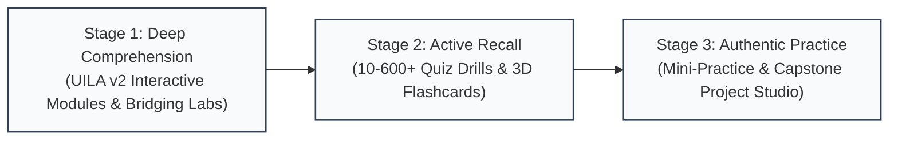

# 1. Introduction and Goals

> [!INFO] **Architecture Provenance & Freshness**
> - **Verified Commit**: `0ae4951` (branch: `main`)
> - **Verified Timestamp**: `2026-11-25T09:23:22Z`
> - **Tracked Paths**: `apps/`, `packages/`, `scripts/`
> - **Drift Status**: `verified`

The primary goal of FlashLearn is:
**To help learners genuinely understand complex concepts, retain them through active recall, and prove mastery by producing authentic real-world work—eliminating *Tutorial Hell* and *Imposter Syndrome*.**

Traditional self-study platforms and corporate courses often stop at passive reading or multiple-choice trivia. Learners finish dozens of chapters yet freeze in front of a blank canvas when asked to build software, write an architecture decision record, analyze real financial cash flows, or apply operational SOPs.

FlashLearn bridges this gap through a unified **3-Stage Learning Loop**:
1. **Stage 1 — Deep Comprehension (`interactive_module`, `materi`)**: Guided single-focus modules using Clement & Brown Bridging Analogies, interactive micro-labs, dual-coded visual slide decks, and zero-jargon glossaries.
2. **Stage 2 — Active Recall (`quiz`, `combined`, 3D Flashcards)**: Scalable 10–600+ interleaved practice drills, confidence calibration, and Leitner/SM-2 spaced repetition.
3. **Stage 3 — Authentic Practice (`project_mission`)**: Scaffolded independent project studios (`mini_practice` per core unit + `capstone` blank-canvas project) with real-world briefs, constraints, edge cases, single-point self-audit rubrics, persistent proof-of-work storage, and optional fail-fast AI mentor critique.

> **Domain Scope Boundary**: FlashLearn supports knowledge-work, software, architecture, finance/business, data analytics, and internal document/SOP readiness. It does **not** issue statutory or physical life-safety practice licenses (such as clinical surgery or aircraft/aviation airworthiness licensing).

---

## 1.1 The 3-Stage Learning Progression to Authentic Production

### Stage 1: Deep Comprehension (Guided Single-Focus Modules)
- Learners explore structured units with one clear action per screen (`InteractiveModuleViewer.svelte`), interactive anchoring labs, explicit analogy breakpoints, inline figures, and auto-resumed progress (`learner_content_progress`).

### Stage 2: Active Recall & Spaced Retention
- Learners drill concepts via micro-sessions (`10/20/30/50`), Active Practice 1-per-screen with Confidence Calibration, and 3D tactile Flashcards with Leitner Re-Queue and SM-2 spaced scheduling.

### Stage 3: Independent Project Missions (`project_mission`)
- Learners escape *Tutorial Hell* by building real-world deliverables (`ProjectMissionViewer.svelte`), verifying their own work against a deterministic Single-Point Self-Audit Rubric, persisting Proof-of-Work (`project_mission_submissions` for both authenticated and guest learners), and optionally requesting non-spoiler AI Mentor critique (`POST /api/v1/contents/:id/project-critique`).
- Every workspace is deterministically verified via `flashlearn workspace audit <id-or-slug> --strict` to ensure all three stages are present and complete.

---

## 1.2 Quality Goals (Q42 Model)

| Priority | Quality Tag | Quality Goal | Description & Target Metric |
|---|---|---|---|
| 1 | #correctness | Operational Competence & Fail-Fast Evaluation | Zero silent auto-passes on misconfigured tasks or offline LLMs. Class A deterministic formulas enforce $\le \pm 1\%$ relative tolerance (`OracleEvaluatorClassA`), Class B/Adversarial fail fast when AI Gateway is unavailable, and prerequisite DAGs are Tarjan SCC verified acyclic. |
| 2 | #maintainability | Modular Architecture & Type-Safe Production Integrity | 100% of files stay under 400 lines (`bun run lint:srp`), 0 TypeScript compiler errors (`tsc --noEmit` across `shared`, `cli`, `api`), 0 mock/fake-latency leakage in production paths (`detect-mocks .`), and 100% domain-agnostic core logic. |
| 3 | #performance | Responsive Learning Flow & Low-RAM Efficiency | Smooth interactive SPA and fast API responses targeting sub-50ms P95 on non-LLM endpoints and under 256MB container RAM on ARM64 Linux. |
| 4 | #security | Tamper-Proof Audit Trails & Credential Trust | Socratic/attempt transcripts anchored with SHA-256 Merkle roots (`merkle-transcript.ts`), authority passports digitally signed using Ed25519 (`DataIntegrityProof` `eddsa-rdfc-2022`), zero hardcoded secrets in source, and XSS-safe Markdown sanitization. |

---

## 1.3 Stakeholders & Operational Beneficiaries

| Stakeholder / Persona | Role & Context | Primary Need & Expected Value |
|---|---|---|
| **Learner / Candidate** | Professional acquiring new operational responsibilities | Needs transparent step-by-step guidance, grounded regulatory references, safe sandbox practice, and portable verifiable credentials. |
| **Organizational Leader / Authority Delegator** | Division head, project director, or hiring manager | Needs evidence-backed assurance that certified personnel pass authentic, unaided assessments and maintain non-decayed competence. |
| **Domain Curriculum Author / Coding Agent** | SME or autonomous agent authoring blueprints | Needs a declarative, schema-validated JSON blueprint workflow (`flashlearn domain validate-blueprint` / `import-blueprint`) without modifying core code. |
| **Compliance & Quality Auditor** | Regulatory or governance inspector | Requires immutable audit trails (`audit_logs`, Merkle roots) and offline-verifiable Ed25519 credentials. |
| **System Operator** | Platform & DevOps engineer | Demands deterministic builds, safe advisory-locked migrations, AI gateway health checks (`/api/v1/health/ai`), and hermetic verification gates. |
